# QueueLK

A live queue system for Sri Lankan dispensaries, clinics and counters: a screen on the wall,
a page on the patient's phone, a console for the receptionist and an Android app for patients
who want one.

This repo is the public write-up. The product code is private because I may run QueueLK as a
business. **Full source is available to interviewers on request**: email me and I'll add you as a
read-only collaborator for the length of the process.

Janindu Gayanga · [iamjanindu.com](https://iamjanindu.com) · [LinkedIn](https://www.linkedin.com/in/janindu-gayanga-02ba60217) · janindugayanga10@gmail.com

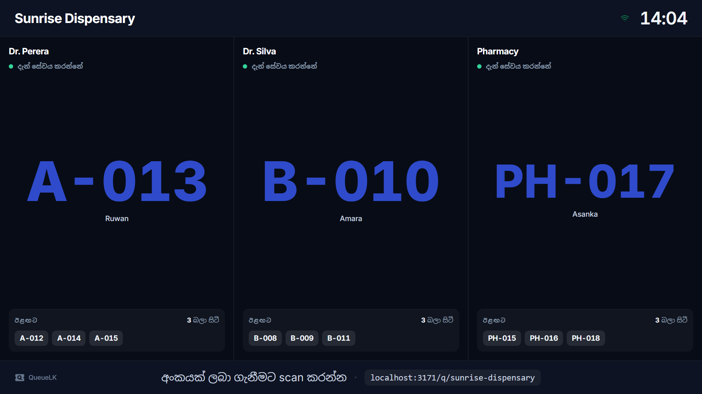

## Why I built it

In a typical dispensary back home, two or three doctors see patients in turn. You walk in, get a
paper number, and have no idea if they're on 12 or 40. So you either sit on a plastic chair for two
hours, or you go to the shop and come back to find your number went fifteen minutes ago. The staff
spend the session shouting numbers over a ceiling fan.

QueueLK replaces that with a QR code at the door. The patient scans it, takes a number, and sees how
many people are ahead and roughly how long it'll be. Their phone buzzes when they're two away and
again when they're called. Nothing to install (the app is optional), and it's in Sinhala, Tamil and
English.

## What it does

- Patients take a number by QR, watch their position and ETA live, and get sound, vibration, Web
  Push or Expo push alerts. They can give up their place from the phone.
- The TV display shows "now serving" for each queue and rotates its labels through three languages.
  It runs on a cheap Android TV stick.
- The staff console is built for one thumb on a tablet: call next, recall, skip, no-show, done, with
  N/R/S keyboard shortcuts. It shows whether its socket is live.
- Owners get a dashboard, reports (median wait by hour, no-show rate, staff throughput, CSV export),
  a printable trilingual QR poster, and an optional nightly three-line summary.
- Counter staff can issue walk-in tokens and print them on a 58/80 mm thermal printer.
- Multi-tenant from the start: every table carries `tenantId` and every query filters on it.

## Screenshots

All taken from the seeded demo clinic. The names are made up.

| | |
|---|---|
| 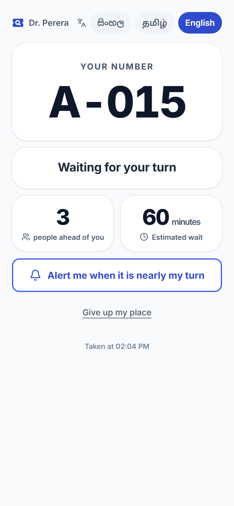 Patient's phone, `/t/[publicId]` | 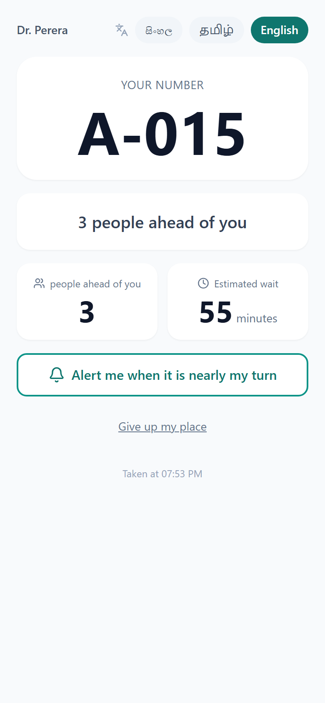 Two away: the alert state |
| 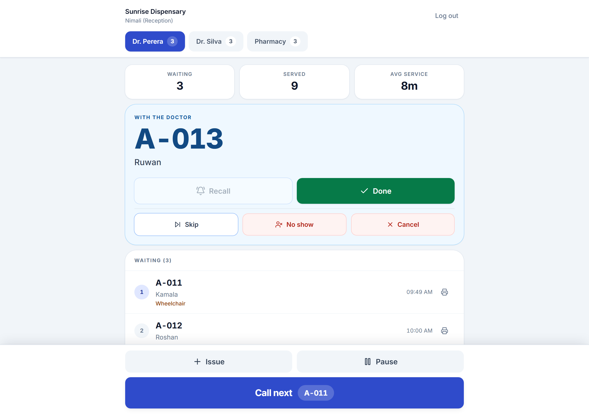 Staff console | 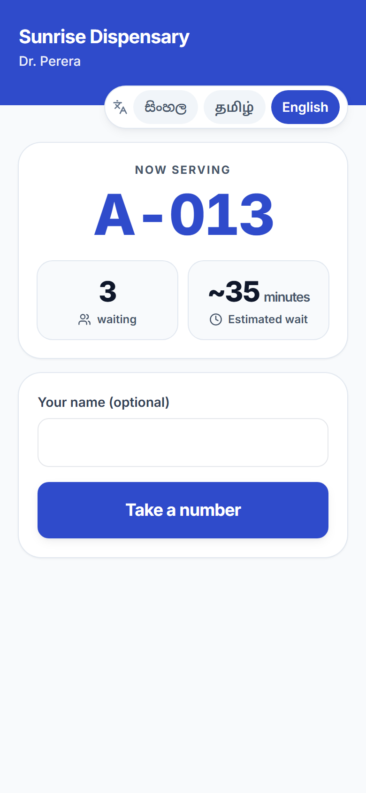 Take a number, after scanning |
| 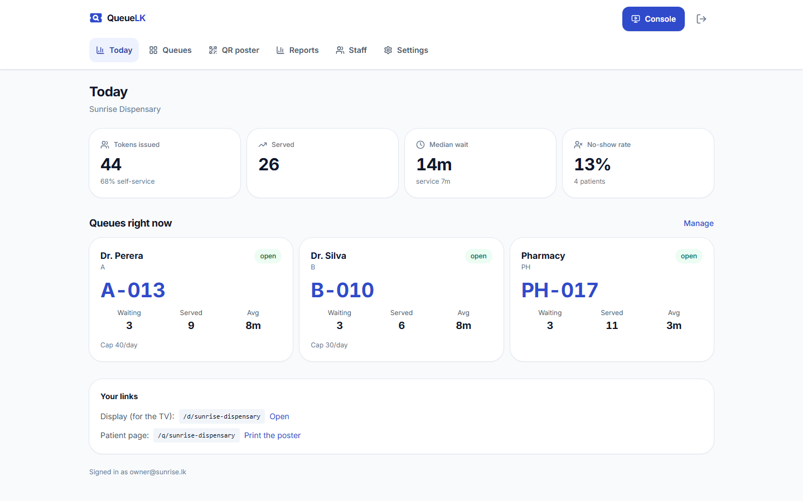 Owner dashboard | 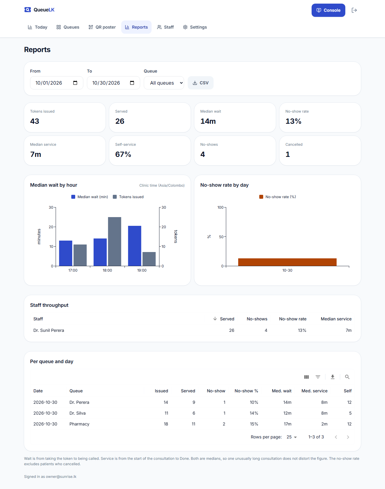 Reports (the only page using MUI X) |
| 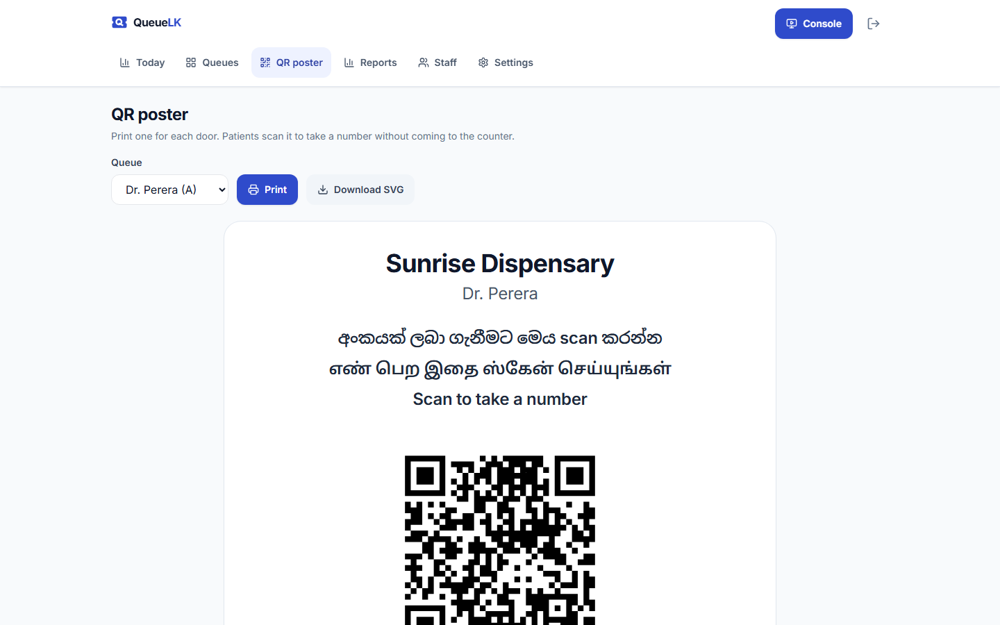 QR poster, from a hand-written QR encoder | 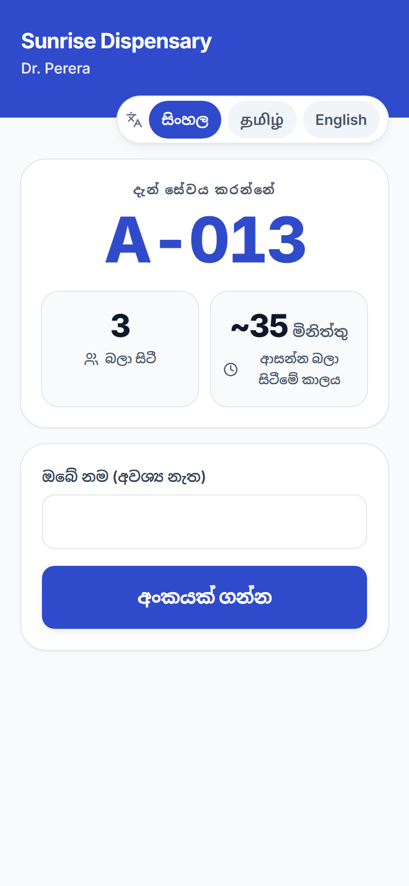 Sinhala, Tamil, English |
| 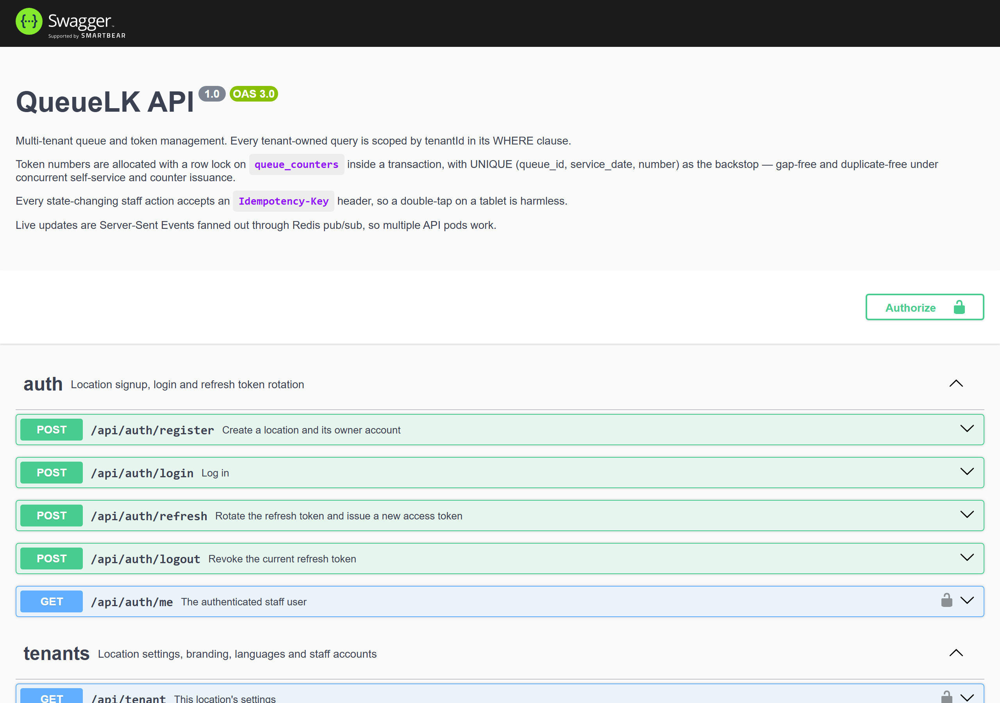 API docs at `/docs` | 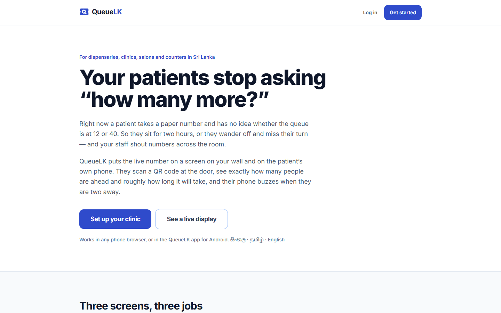 Landing page |

There are no screenshots of the Expo app yet. That needs a real phone and an APK build, which I
haven't done.

## Architecture

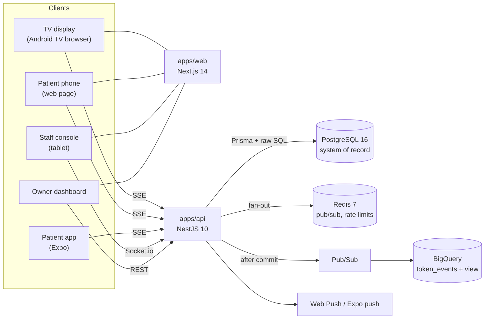

The rule everything rests on: **Postgres is the only system of record, and Redis is allowed to
disappear.** Numbers come from a Postgres row lock, idempotency records are written in the same
transaction as the action, and the capacity cap is checked inside that transaction. If you flush
Redis, the clinic keeps issuing correct numbers and the screens go stale until they reconnect.

On GCP the plan is Cloud Run for the API and web app, a Cloud Run job for migrations, Cloud SQL on a
private IP, Pub/Sub with a BigQuery subscription, Secret Manager, Artifact Registry and Upstash Redis.
That's all in Terraform. See [what actually ran](#what-ran-where) before reading too much into it.

## Stack

NestJS 10, Prisma 5, PostgreSQL 16, Redis 7, Socket.io with `@socket.io/redis-adapter`, SSE, Next.js
14 (App Router, Tailwind, TanStack Query, Zustand), MUI X on one page, a hand-written service worker
with Web Push (VAPID), Expo SDK 58 with Expo Router, Pub/Sub and BigQuery, Gemini (optional, free
tier), Terraform for GCP, Sentry, k6, Jest, Supertest, React Native Testing Library, Playwright,
Docker Compose and GitHub Actions.

## The parts I'd want you to read

### Gap-free numbers under concurrency

Thirty patients can scan at the same moment while the receptionist issues a walk-in, and the numbers
that come out are exactly 1 to 31. No gaps, no duplicates.

Issuing takes one lock: the row in `queue_counters` for that queue and day, claimed with a single
`INSERT ... ON CONFLICT DO UPDATE ... RETURNING`. Issuers queue on that row in arrival order. A
`UNIQUE (queue_id, service_date, number)` constraint backs it up in case anything ever bypasses the
service. The device check and the daily cap run in the same transaction, so a rejected token rolls
its number back instead of leaving a hole on the display.

I didn't use Redis `INCR` because Redis isn't the system of record and a crash between the `INCR` and
the `INSERT` burns a number. I didn't use a Postgres sequence because `nextval()` isn't rolled back.

The first version used `SELECT ... FOR UPDATE` on the queue row for everything, and that's where the
load test found the problem (below).

[`samples/numbering/issue-token.excerpt.ts`](samples/numbering/issue-token.excerpt.ts)

### "Call next" on two tablets calls one patient

Counter actions lock the queue row, because the race is in *choosing* which token to call. Two
transactions can both pick the same token before either has locked it. The update is also
conditional (`WHERE status = 'WAITING'`), and every staff action carries an idempotency key, so a
double tap on a slow tablet replays the first response instead of calling a second patient. The
idempotency row lives in Postgres and is written in the same transaction as the action. That's the
whole reason it isn't in Redis.

The lock is `FOR NO KEY UPDATE`, not `FOR UPDATE`. I found that out the hard way: with `FOR UPDATE`,
patients taking a number still waited for the counter, because inserting a token checks its foreign
key to `queues` with `FOR KEY SHARE`, and `FOR UPDATE` blocks that. One test run hung with seven
issuers stuck behind a counter. `FOR NO KEY UPDATE` still serialises counter actions but leaves
issuers alone.

[`samples/numbering/queue-lock.ts`](samples/numbering/queue-lock.ts) ·
[`samples/numbering/locks.e2e-spec.ts`](samples/numbering/locks.e2e-spec.ts) ·
[`samples/idempotency/idempotency.service.ts`](samples/idempotency/idempotency.service.ts)

### A state machine in one file

`WAITING -> CALLED -> SERVING -> DONE | NO_SHOW | CANCELLED`, with the legal transitions as data. The
interesting rules are the illegal ones. `DONE -> DONE` is rejected because it would re-stamp
`completedAt`, which skews the rolling service-time average that every waiting patient's ETA comes
from. The tests walk every (status, action) pair.

[`samples/token-state/`](samples/token-state/)

### Notifications as a chain

Each channel (Expo push, Web Push, SMS) implements one small interface, and a dispatcher walks the
tenant's chain, `expo -> push -> sms`, stopping at the first one that delivers. The free channels
always go first. A "claim" step runs once, right before the first send, so two API instances can't
both notify the same patient. SMS is a stub with a fake provider: I only store a hash and the last
four digits of a phone number, so there's nothing to text yet.

[`samples/notifications/`](samples/notifications/)

## Engineering decisions

The full ADRs are in [`docs/adr`](docs/adr). Short version:

1. **SSE for the public screens, Socket.io for staff** ([0001](docs/adr/0001-sse-for-public-socketio-for-staff.md)).
   The TV and phones only listen, and SSE is plain HTTP that reconnects by itself on a cheap TV
   browser. The console sends commands and needs an answer ("which patient did I just call?"), so it
   moved to Socket.io with a JWT handshake, acknowledged commands and a REST fallback.
2. **Expo for the patient app, on the same SSE stream** ([0002](docs/adr/0002-expo-patient-app.md)).
   Expo push is just another channel in the chain, and the API never holds a Firebase key.
3. **MUI X only on the reports page** ([0003](docs/adr/0003-mui-only-on-the-reports-page.md)).
   The DataGrid saves days of work there, but the TV and patient pages run on cheap hardware and
   shouldn't pay for it. Both styling systems read the same token file, with a test that fails if
   they drift.
4. **Token events to BigQuery through Pub/Sub, after commit** ([0004](docs/adr/0004-token-events-to-bigquery.md)).
   Not a transactional outbox: losing one analytics row in a crash is fine for trend charts. Events
   carry a deterministic `event_id` so redelivery is counted once, and no patient data goes to the
   warehouse.
5. **Upstash instead of Memorystore** ([0005](docs/adr/0005-upstash-redis-instead-of-memorystore.md)),
   because Redis holds nothing that matters and Memorystore costs money every hour.
6. **Cloud Run instead of GKE** ([0006](docs/adr/0006-cloud-run-instead-of-gke.md)). Scales to zero
   overnight. The cost is a 60-minute cap on WebSocket and SSE connections, which the clients already
   handle by reconnecting.
7. **Issue on the counter row only** ([0007](docs/adr/0007-issue-on-the-counter-row-only.md)), the
   lock change described above.

## Numbers

**Load test.** A k6 "morning rush": 300 patients take numbers within 60 seconds while 5 counters keep
calling and finishing, all on one queue. The teardown checks the numbers are exactly 1..N, unique,
and that nobody was called twice.

- After the lock change, take-number p95 was **71 to 91 ms** (the old build: 91 to 132 ms, run
  interleaved in the same session). p99 dropped in every paired round. Target was 250 ms.
- No gaps, duplicates or double calls in any run: about 2,100 tokens on day one and 3,300 on day two.
- Day one missed the target (377 ms at best) on a laptop that was also running other projects. Most of
  that turned out to be the machine. One run did find a real bug: making the broadcast after an issue
  fire-and-forget exhausted the Prisma pool and p95 went to 7.6 s. I fixed it by coalescing broadcasts
  per queue and wrote a [postmortem](docs/postmortems/2026-10-30-morning-rush-pool-exhaustion.md).

Honest caveat: k6 and the API shared one laptop's CPU. A run on Cloud Run is the next check.
[Full report](docs/LOAD-TEST-REPORT.md) · [the script](samples/load/morning-rush.js)

**Tests** (counted 2026-10-31):

| Suite | Tests |
|---|---|
| API unit | 235 |
| API integration, real Postgres + Redis | 113 |
| Analytics, on the Pub/Sub and BigQuery emulators | 3 |
| Web unit | 44 |
| Playwright | 10 |
| Mobile (Jest + React Native Testing Library) | 72 |
| Terraform plan-time tests | 8 |

The integration tests hit a real Postgres on purpose. A mocked version of the concurrency tests would
pass against code with no locking at all, which is exactly the bug they exist to catch.

## What ran where

Everything ran on my Windows laptop. Nothing has run on a real GCP project yet.

- Postgres and Redis in Docker, for the integration suite and the k6 runs.
- Pub/Sub on Google's official emulator and BigQuery on the goccy emulator. The emulator has no
  BigQuery subscriptions, so a small loader stands in for that step locally.
- Terraform: `terraform validate`, 8 `terraform test` runs on mocked providers, and an offline plan
  (89 resources). Never applied.
- The CD workflow (keyless, Workload Identity Federation) is written but has never run.
- Observability: JSON logs, log-based metrics, a dashboard and an SLO (display updates within 2 s of
  "call next") are in Terraform; Sentry is wired into the API, web and app with an optional DSN.
- The Expo app is tested with Jest and an Android bundle export. No APK yet.

## Not built yet

- Real SMS or WhatsApp. The interface is there; an encrypted phone vault isn't.
- Billing. `tenants.plan` and a `features` column exist and already drive the notification chain.
- Appointments, multi-branch owners.
- Delivering the nightly summary by email or push. It's stored and shown on the reports page.
- Expo push receipts aren't polled, only the immediate ticket.

If I started again I'd write the load test in week one. The lock design looked right in the
integration tests for weeks, and it took 300 fake patients to show me where the time went.

## More docs

- [Architecture](docs/01-ARCHITECTURE.md): the life of one token from QR scan to done, failure modes,
  what I rejected and why.
- [Database](docs/02-DATABASE.md): every table, the state machine, the numbering invariant, indexes.
- [Security](docs/03-SECURITY.md): threat model (500 fake tokens, a stolen tablet, a rival reading
  your queue) and a list of what isn't handled.

## License

Copyright (c) 2026 Janindu Gayanga. All rights reserved. See [LICENSE](LICENSE). You can read this
repo; you can't copy, modify, distribute or use any of it commercially.
